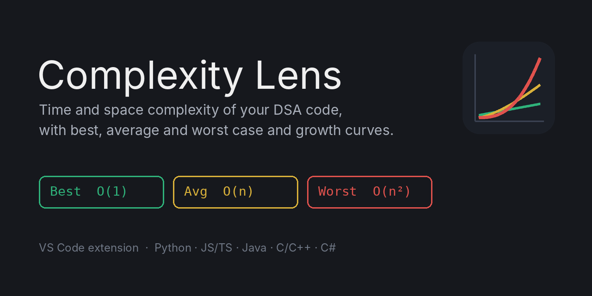
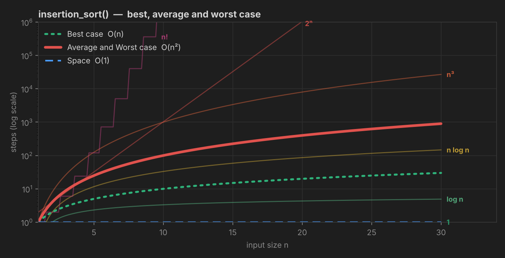
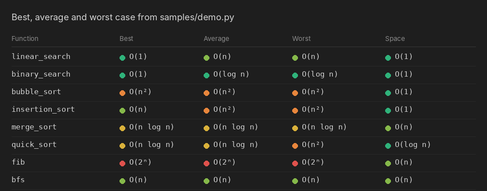

<p align="center"></p>

# Complexity Lens

See the **time** and **space** complexity of your DSA code right in VS Code, including the **best, average and worst case**, with growth-curve graphs.

> Static, heuristic analysis. A study aid and sanity check, not a proof. See [Limits](#limits).

## Features

- **CodeLens above every function**, e.g. `⏱ Best O(n) · Avg O(n²) · Worst O(n²) · 💾 Space O(1)`. Click it to open the visualizer.
- **Best, average and worst case** with a one-line reason for each (early `return`/`break`, data-dependent inner loops, pivot choice in quicksort, tree height in BST lookups…).
- **Growth chart**: your function's curve over O(1), O(log n), O(n), O(n log n), O(n²), O(n³), O(2ⁿ), O(n!). Drag the *n* slider, switch log/linear, hover for exact step counts, and overlay the best/average/worst curves.
- **Operations at n**: bars showing how many steps each class takes at your chosen n.
- **Why this estimate**: plain-language reasons (nested loops, halving loops, recurrences, list-vs-set lookups) and tips such as "use a set here" or "add memoization".
- **Editor hints**: the line that dominates the running time is tinted, loop headers show `⟵ O(n²)`, and the status bar shows the worst function in the file.
- **Copy as Markdown**: one click copies a Best / Average / Worst / Space table of all functions.

<p align="center"></p>
<p align="center"></p>

_The images above are rendered from the analyzer's real output on `samples/demo.py`, not screenshots of the VS Code window._

## Usage

| Action | How |
|---|---|
| Analyze the current file | `Ctrl/Cmd+Alt+C`, the graph icon in the editor title bar, or the status-bar badge |
| Analyze only some code | Select it, then right-click → **Complexity Lens: Analyze Selection** |
| Toggle CodeLens / inline notes | Command Palette → **Complexity Lens: Toggle …** |

Supported languages: Python, JavaScript, TypeScript, Java, C, C++, C#.

## What it understands

Nested and dependent loops · halving/doubling and binary-search loops · √n loops · sieve-style harmonic loops · BFS/DFS/Dijkstra (V+E amortization) · recursion via recurrences (Master theorem, linear, exponential, tree traversal, memoized DP, subset/permutation backtracking) · sorting, heap, hash-set/map, list-membership, slicing and copy costs · calls between functions in the same file · auxiliary space from arrays, growing containers, recursion depth and memo tables.

## Settings

| Setting | Default | Meaning |
|---|---|---|
| `complexityLens.codeLens` | `true` | CodeLens above functions |
| `complexityLens.inlineAnnotations` | `true` | `⟵ O(…)` at loop headers |
| `complexityLens.highlightHotspots` | `true` | Tint the dominating line(s) |
| `complexityLens.analyzeOnType` | `true` | Re-analyze while typing (debounced) |
| `complexityLens.statusBar` | `true` | Status-bar badge |

## Limits

This is a **static heuristic**. It assumes a single input size `n` and the usual cost of library calls. It can be wrong for amortized tricks, data-dependent loop bounds, two-variable bounds (O(n·m) is shown as n²), hash collisions, or cost hidden in functions defined elsewhere. Average case is reported only where the pattern is well known (quicksort, BST lookup, early-exit scans); otherwise it equals the worst case.

## Install

- **From a release**: download `complexity-lens-0.2.0.vsix`, then `code --install-extension complexity-lens-0.2.0.vsix`.
- **From source**: clone, open the folder in VS Code and press `F5`. No build step and no runtime dependencies.
- **Build a .vsix yourself**: `npx @vscode/vsce package`.

## Develop

```bash
npm test      # 29 algorithm checks + 9 case checks + UI and extension smoke tests
```

Layout: `src/analyzer.js` (pure JS, no VS Code API), `extension.js` (CodeLens, decorations, panel host), `media/` (webview UI and icon), `samples/` (try-me files), `test/`.

## License

MIT
